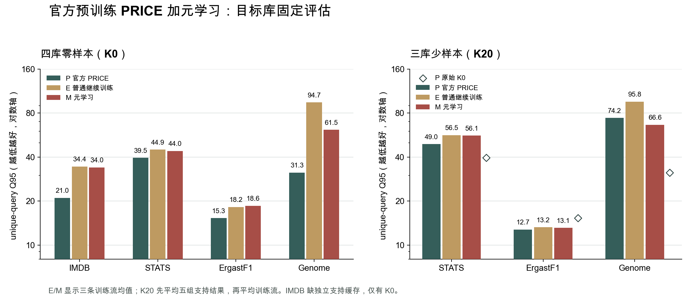

# 126 四目标固定评估结果

日期2026-11-18。用户授权：“那就开始四个目标库的评估吧，看看效果怎么样”。

**242/242格完成、437,848行预测独立复算通过。M相对普通继续训练E有部分收益，但未达到整体改善标准：M20/E20的Q95降低12.43%，M20/P20仅降低1.70%；M20比自身M0高7.36%，比官方P0高32.47%。四库M0/P0高43.93%，零样本保护失败。** 不据目标成绩追加训练、选LR或换支持集。

## 来源与覆盖

P为官方26库发布权重；E/M来自125封存三条训练流42/43/44的2000更新last，七份权重全部核验。125 binding为`220400d2…f0e17`，seal SHA `299b0cbf63f41950f54d1abc94ac0d095eaf3fa2fce553b681280d457c7159f4`，六训练加seal均完成，累计监督11.48693小时。见[训练封存](training125/seal-completion.json)、[训练链](training125/continuation-completed.json)。

本轮分支`experiment/price-meta126-targets-20261118`，base`947addb`；服务器根`/gly/weilin/price-meta-126-targets-20261118`。binding `aee21c8945b2d976bdd31dc93a6985047028f1cd5829e4e62d1c94c36136a105`固定38个执行依赖、协议、目标计划与七份权重SHA；原训练、权重和缓存只读。见[binding](binding.json)、[目标计划](target-plan.json)、[126协议](../../实验文档/126-官方PRICE元学习四目标评估.md)。

| 库 | 原始test行 | unique-query分母 | 独立支持池（移除test重叠后） | 覆盖 |
|---|---:|---:|---:|---|
| IMDB | 766 | 521 | 无finetune缓存 | K0 |
| STATS | 2749 | 2603 | 49959 | K0/K5/K20 |
| ErgastF1 | 1422 | 1258 | 49705 | K0/K5/K20 |
| Genome | 2302 | 1699 | 49609 | K0/K5/K20 |

IMDB缺支持由真实路径检查固化，K>0为`unavailable_missing_independent_support`，不借test补support。其余三库固定100条无放回支持查询，分5组20条互不重叠，K5取每组前5，所有模型/流共享身份。支持池剔除与test重叠的hash分别41/294/164条。test全部canonical去重，冲突即拒绝，不过滤失败或长查询。

固定原生MSE、alpha1e-6、全参数SGD5步；适应/预测eval，临时参数每格重置，公共state前后SHA相同。PG用原始double缓存、相同unique-query分母现场重算，不引用论文或历史all-rows数字。

## 逐库Q95

越低越好。E/M为三训练流算术均值；K20先对每流每库五block Q95平均，再对三流平均。P是一个公共模型，PG不适应。

| 库 | P官方 K0 | E K0 | M K0 | P K20 | E K20 | M K20 | PG K0 |
|---|---:|---:|---:|---:|---:|---:|---:|
| IMDB | 21.025 | 34.445 | 34.014 | — | — | — | 87.110 |
| STATS | 39.521 | 44.940 | 44.025 | 49.036 | 56.535 | 56.111 | 75.650 |
| ErgastF1 | 15.293 | 18.208 | 18.568 | 12.748 | 13.235 | 13.088 | 27.609 |
| Genome | 31.336 | 94.722 | 61.463 | 74.153 | 95.761 | 66.612 | 1907.321 |

M20相对E20的逐库变化为STATS−0.75%、ErgastF1−1.11%、Genome−30.44%（本句按表中三流均值之比）。因此收益集中于Genome，另两库差异小，不能称三库均明确改善。

## 预定聚合与判定

K20主聚合每流每库先平均五block Q95，再对三个支持可用库取log等权平均L，最后`exp(mean_s(L_M-L_reference))`。不同于直接相除上表均值，也不pool查询。四库K0几何比较另列，不与三库K20混分母。

| 冻结比较 | 比值 | Q95相对变化 | 改善流 |
|---|---:|---:|---:|
| M20/E20 | 0.87573 | −12.43% | 2/3 |
| M20/P20 | 0.98297 | −1.70% | 1/3 |
| M20/M0 | 1.07360 | +7.36% | 1/3 |
| M20/P0（三库） | 1.32469 | +32.47% | 0/3 |
| M20/E0（三库） | 0.89310 | −10.69% | 2/3 |
| M0/P0（四库） | 1.43933 | +43.93% | — |
| M0/E0（四库） | 0.89448 | −10.55% | — |
| E0/P0（四库） | 1.60913 | +60.91% | — |

判定`partial_target_signal`，四个事前门均false：对P20收益未达5%；M20反而比自身M0差；K0保护失败；逐库Q50/Q95保护失败。M20相对自身M0有21/45个block负迁移，按流×库的五block均值为5/9退化。Genome的M20仍为P0约2.13倍，STATS约1.42倍；仅胜过退化E不足以声称胜过官方PRICE。

本轮结论限定于这一固定初始化/预算/适应配方，不推广为FOMAML整体无效。三流共享一个P，五支持block共用test，不是独立预训练复现或显著性检验；目标有历史观察，不称新盲测。完整覆盖为四库K0、三库fewshot，IMDB少样本尚无结果。不做数据库端到端收益结论。

## 执行与验收

GPU0整卡UUID监督一次成功，560.0776秒（9.33分钟），exit0、无failure；VRAM峰值773,849,088B（约0.721GiB）、RSS1,168,842,752B（约1.089GiB）、输出28,847,597B，均在3h/12GiB/24GiB/1GiB内。最大单格约3.02秒，未触120秒门；结束卡回1MiB/0%，无重试。

STATS统一扩展padding为(12,14,8,10)，不筛长查询/截断。七份模型全2603条test扩展前后输出最大差均3.8147e-6，state键/形状/字节同；真实长support20条完整前向有限。见[布局验证](layout-compatibility.json)。

生产侧逐CSV与在线指标一致；另一个不导入生产metrics/aggregate的[验证脚本](verify_outputs.py)复核437,848行身份/顺序/原始标签/PG来源/解码/Q50/Q90/Q95/Q99，五项主比率、三项K0比率和21/45负迁移一致。见[独立验证](independent-verification.json)、[格级指标](units.json)、[摘要](summary.json)、[监督](evaluate.supervisor.json)、[完成记录](completion.json)。242份完整CSV约28MB留服务器。

最终冻结版本本地全量**1929项OK(22skip)**，344.257秒、exit0，见[最终日志](local-final-full-suite.log)；初轮1928项通过日志亦保留。Linux172专项全过、无skip，见[Linux日志](linux-tests.log)。Ruff/format/diff与38文件SHA检查通过。独立只读审查另跑43项126专项，从units手算全部主要比率及失败门，结论无阻塞、无口径夸大；审查者未SSH逐行读CSV，逐行验证来自主代理独立脚本，限制如实保留。

后续新配方须另立协议与开发证据，不根据本批目标成绩继续扫本轮LR/步数。本轮完成固定评估与结果归档。
