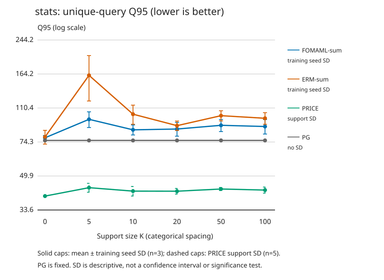
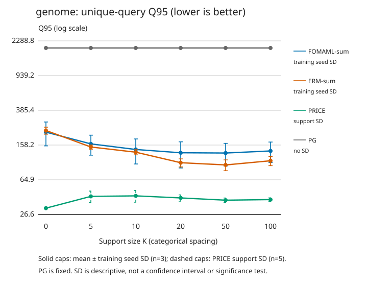
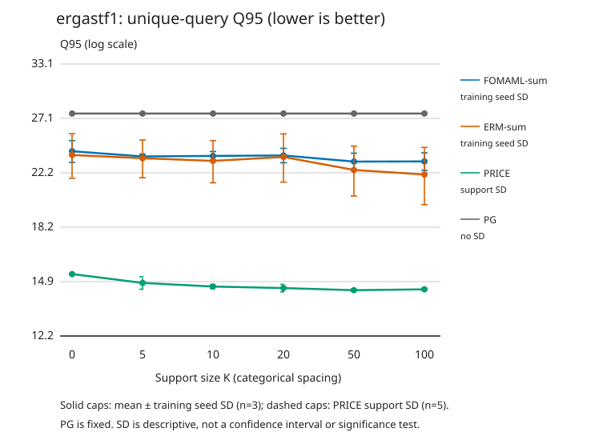
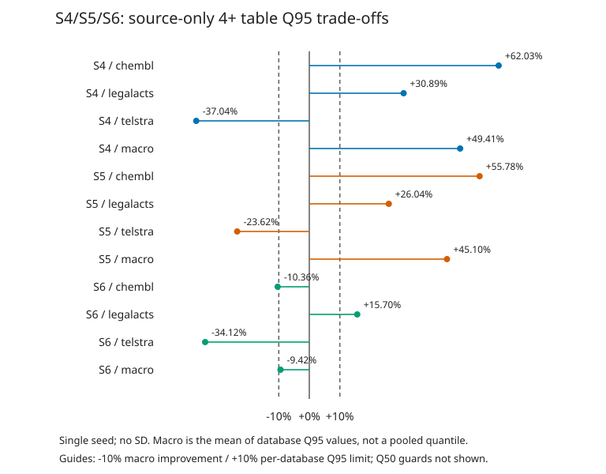

# 25 论文实验章节与图表初稿

> 编排日期：2026-10-07；证据基准：`8fe6de4`。本章仅编排既有正式离线结果，不包含新训练、推理、适应、目标评估或数据库计数。本文是完整实验章初稿，不是完整毕业论文，也不假定学校模板、论文总章号或新文献。

## 1. 实验目的与设置

本研究考察空间漂移下的监督式跨数据库少样本基数估计：在源数据库学习共享初始化，在未参与训练的目标数据库使用少量有真实基数标签的查询进行适应。实验关注尾部误差、适应的正负迁移以及模型规模，不研究时间漂移、上下文学习或 PostgreSQL 插件。下文将历史目标评估、源侧受控消融和后验诊断分别呈现，避免将不同端点合并成一个效果结论。

### 1.1 数据划分与适应协议

26 个源数据库中，23 个用于训练，`chembl/legalacts/telstra` 仅用于源验证和方法选择。目标名单为 `imdb/stats/genome/ergastf1`，不进入训练、超参数、适应策略或 checkpoint 选择。本章有完整 few-shot 结果的目标仅为后三库，IMDB 的完整支持集尚不可认证，不能写成四库验收完成。

目标 support 来自独立 finetune workload，test 来自测试 workload；按保守 SQL 规范化身份去重，支持池排除与 test 重叠的查询。规范化身份不保证穷尽 SQL 语义等价。每个 repeat 使用嵌套支持集合，全部保留 K=0/5/10/20/50/100，不根据目标误差选择最佳 K。

**表 1 目标评估规模与支持池。** 以下分母来自既有结果包，不是本轮读取原始目标数据后的重新认证。

| 目标库 | all-rows | unique-query | support 去重数 | 重叠排除数 |
| --- | --- | --- | --- | --- |
| stats | 2749 | 2603 | 49959 | 41 |
| genome | 2302 | 1699 | 49609 | 164 |
| ergastf1 | 1422 | 1258 | 49705 | 294 |

源验证冻结的适应策略为全部参数更新、5 步、学习率 `0.001`；PRICE 的学习率按源验证选择为 `1e-06`。FOMAML 以数据库为任务执行一阶元学习；ERM 是同结构、同源划分的监督初始化，随后采用相同目标适应预算。PG 是固定估计、不随 K 适应；PRICE 使用已有预训练权重。不同历史训练使用源验证的 early stopping/best checkpoint；S4–S6 另采用固定 4000 更新的 last.pt。历史适应评估与源侧零样本端点不能互换。

### 1.2 指标与不确定性

标准 Q-error 定义为 `max(max(pred,1)/max(true,1), max(true,1)/max(pred,1))`。主指标为 unique-query Q95，越小越好；Q50 为辅助中位数指标。不混用 all-rows、PRICE shifted `(pred+1)/(true+1)`、pooled Q95 或 mean log-Q95。

目标模型采用三个独立训练 seed（42/43/44），每个 seed 有五次 support 抽样。先求每个 seed 的五个 episode Q95 的算术均值，再对三个均值求均值与样本 SD（ddof=1）。不是合并逐查询预测后重算分位数，也不是 15 个独立训练重复。PRICE 只有单个提供的 checkpoint，其 support SD 单列；PG 没有适应波动。SD 仅描述重复波动，不是置信区间，不支持显著性结论。

源侧结构选择使用适应后的三库 macro mean log-Q95；P0 使用库内表数桶比值及库间的几何平均；P1 与 S4–S6 使用各源验证库完整 4+ 表群体 Q95 的等权算术 macro。S4–S6 仅 seed42，没有训练 seed SD，不能与目标跨 seed 表合并。

## 2. 轻量模型规模与源侧结构选择

轻量网络以共享 token MLP 编码连接列直方图、fanout、表和过滤特征，使用集合池化，输出对 PG 对数估计的残差。sum 是源验证选择的参考结构；初始残差输出为零，因此从 PG 起点开始，不等于随机基数预测。

**表 2 参数规模。** FP32 纯参数字节不含优化器、checkpoint 元数据和预处理开销。

| 模型 | 参数数 | FP32 参数字节 | PRICE / 本模型 |
| --- | --- | --- | --- |
| FOMAML-set | 99,777 | 399,108 | 107.33× |
| FOMAML-sum | 132,545 | 530,180 | 80.80× |
| PRICE | 10,709,330 | 42,837,320 | 1.00× |

当前 sum 模型约为 PRICE 参数数的 1/80.80；107.33×仅对应 set，不用于 sum。参数缩减不等于训练时间比、checkpoint 体积比或数据库端到端加速。

**表 3 源验证结构选择：macro mean log-Q95（非目标主表 Q95）。**

| 结构 | 三 seed 均值 | 训练 seed 样本 SD |
| --- | --- | --- |
| set | 2.655437 | 0.011807 |
| sum | 2.617780 | 0.026366 |
| attn | 2.658369 | 0.046360 |
| attn_pair | 2.637666 | 0.048478 |

按历史源验证均值选择 sum，不依据下文目标结果改选结构。不同结构的参数量及历史 best checkpoint 不同，不能把 set/sum 差异单独归因于表示结构，有限变体结果也未排除表示层瓶颈。

## 3. 三目标库完整 K 对照

表 4–6 中四个轻量模型为均值 ± **训练 seed SD**；PRICE†单列均值与 **support SD**，二者不是同一种重复；PG 单列固定值。图 1–3 展示源侧选定的 sum 主线，set 的全部 K 同样保留在表和 CSV。SVG 使用 Q95 对数轴与等间距分类 K 轴：后者不表示支持数差值的线性距离。实线帽表示训练 seed SD，虚线帽仅表示 PRICE support SD。

### stats

**表 4 stats 标准 unique-query Q95（越小越好）。**

| K | FOMAML-set | ERM-set | FOMAML-sum | ERM-sum | PRICE† 均值 | PRICE support SD | PG |
| --- | --- | --- | --- | --- | --- | --- | --- |
| 0 | 77.32 ± 2.50 | 79.37 ± 5.87 | 78.02 ± 2.13 | 78.77 ± 6.32 | 39.52 | 0.00 | 75.65 |
| 5 | 96.29 ± 10.02 | 116.06 ± 18.58 | 96.77 ± 8.85 | 161.68 ± 41.80 | 43.59 | 2.26 | 75.65 |
| 10 | 85.74 ± 4.21 | 91.99 ± 9.88 | 85.61 ± 4.97 | 102.75 ± 11.39 | 41.88 | 2.33 | 75.65 |
| 20 | 84.20 ± 3.94 | 88.70 ± 8.28 | 86.41 ± 6.94 | 89.87 ± 4.94 | 41.83 | 1.39 | 75.65 |
| 50 | 90.04 ± 7.58 | 97.91 ± 11.58 | 90.25 ± 6.38 | 100.98 ± 5.95 | 42.92 | 0.75 | 75.65 |
| 100 | 86.76 ± 5.35 | 94.81 ± 12.36 | 88.98 ± 7.47 | 97.96 ± 6.60 | 42.39 | 1.49 | 75.65 |



**图 1。** stats 完整 K 曲线及描述性 SD；PG 不添加误差条，PRICE 不添加训练 seed SD。逐点精确值见 `target-q95.csv`。

### genome

**表 5 genome 标准 unique-query Q95（越小越好）。**

| K | FOMAML-set | ERM-set | FOMAML-sum | ERM-sum | PRICE† 均值 | PRICE support SD | PG |
| --- | --- | --- | --- | --- | --- | --- | --- |
| 0 | 248.69 ± 67.29 | 374.09 ± 27.35 | 220.30 ± 65.47 | 229.64 ± 20.65 | 31.34 | 0.00 | 1907.32 |
| 5 | 171.96 ± 32.59 | 220.31 ± 23.75 | 162.91 ± 40.92 | 150.39 ± 7.98 | 42.40 | 6.20 | 1907.32 |
| 10 | 135.47 ± 14.76 | 171.81 ± 13.80 | 141.12 ± 43.79 | 131.63 ± 8.66 | 42.96 | 6.45 | 1907.32 |
| 20 | 122.99 ± 17.43 | 129.99 ± 14.41 | 129.76 ± 41.94 | 100.51 ± 10.34 | 40.75 | 3.29 | 1907.32 |
| 50 | 125.63 ± 17.27 | 124.14 ± 13.65 | 128.89 ± 36.38 | 94.96 ± 13.11 | 38.45 | 2.21 | 1907.32 |
| 100 | 137.66 ± 22.13 | 137.33 ± 14.48 | 135.94 ± 34.81 | 105.71 ± 12.49 | 39.05 | 1.76 | 1907.32 |



**图 2。** genome 完整 K 曲线及描述性 SD；PG 不添加误差条，PRICE 不添加训练 seed SD。逐点精确值见 `target-q95.csv`。

### ergastf1

**表 6 ergastf1 标准 unique-query Q95（越小越好）。**

| K | FOMAML-set | ERM-set | FOMAML-sum | ERM-sum | PRICE† 均值 | PRICE support SD | PG |
| --- | --- | --- | --- | --- | --- | --- | --- |
| 0 | 24.53 ± 0.91 | 26.14 ± 2.02 | 24.03 ± 0.96 | 23.70 ± 1.94 | 15.29 | 0.00 | 27.61 |
| 5 | 23.69 ± 1.52 | 24.24 ± 1.24 | 23.58 ± 0.20 | 23.42 ± 1.62 | 14.80 | 0.34 | 27.61 |
| 10 | 24.10 ± 1.50 | 24.66 ± 1.79 | 23.62 ± 0.39 | 23.20 ± 1.80 | 14.61 | 0.11 | 27.61 |
| 20 | 24.18 ± 1.19 | 24.02 ± 2.13 | 23.66 ± 0.63 | 23.53 ± 2.08 | 14.53 | 0.20 | 27.61 |
| 50 | 23.91 ± 1.64 | 23.49 ± 1.75 | 23.13 ± 0.73 | 22.43 ± 2.06 | 14.41 | 0.07 | 27.61 |
| 100 | 23.75 ± 1.63 | 23.46 ± 1.59 | 23.15 ± 0.74 | 22.06 ± 2.31 | 14.46 | 0.06 | 27.61 |



**图 3。** ergastf1 完整 K 曲线及描述性 SD；PG 不添加误差条，PRICE 不添加训练 seed SD。逐点精确值见 `target-q95.csv`。

† PRICE 已有权重使用全部 26 个源库，包括本研究三个验证库；其源数据曝光与轻量模型的 23/3 划分不一致，所以仅为补充参考。三个目标库所有 K 的轻量模型 Q95 均值均高于 PRICE，本章不声称尾部精度优于 PRICE。

### 3.1 适应收益依赖数据库与架构

Genome 中四种轻量组合适应后的 Q95 均值均低于各自 K=0；STATS 中所有非零 K 的 Q95 均值均高于各自零样本结果，表明该批结果保留了负迁移。ergastf1 的 sum 均值变化相对较小，不能将 Genome 的收益推广为普遍单调改善。

在 set 结构下，Genome 的 FOMAML K=0/5/10 优于 ERM；但 sum 结构下 Genome 全部非零 K 的 ERM 均值均低于 FOMAML。例如 K=20 的 FOMAML-sum 为 129.76，ERM-sum 为 100.51。STATS K=5 的 FOMAML-sum 96.77 低于 ERM-sum 161.68，但两者都差于自身 K=0；相对其他方法更好不等于适应本身获益。现有结果不支持跨架构、跨目标的统一元学习优势。

这些是已记录 Q95 均值的描述性比较。历史 `paired_unique_vs_reference` 的参照是 PG，不是本模型 K=0，因此不能据此推算“适应造成多少比例查询恶化”，也不能证明 support 分布、loss 或表示结构是负迁移原因。

### 3.2 中位数与尾部须分别报告

Q50 不能替代尾部 Q95。为减少正文重复，表 7 仅展示 K=0/20/100 切片；完整六个 K 的所有方法 Q50 仍在 `target-q50.csv` 中保留，切片不是模型选择。

**表 7 Q50 的展示切片。** 轻量方法为训练 seed 均值 ± SD；PRICE 仅均值，support SD 见 CSV。

| 库 | K | FOMAML-sum | ERM-sum | PRICE† | PG |
| --- | --- | --- | --- | --- | --- |
| stats | 0 | 2.00 ± 0.04 | 2.02 ± 0.04 | 1.95 | 1.98 |
| stats | 20 | 2.00 ± 0.05 | 2.00 ± 0.04 | 1.99 | 1.98 |
| stats | 100 | 2.01 ± 0.05 | 2.04 ± 0.03 | 1.99 | 1.98 |
| genome | 0 | 1.32 ± 0.20 | 1.25 ± 0.08 | 1.89 | 1.19 |
| genome | 20 | 1.32 ± 0.19 | 1.38 ± 0.01 | 1.61 | 1.19 |
| genome | 100 | 1.32 ± 0.19 | 1.35 ± 0.03 | 1.64 | 1.19 |
| ergastf1 | 0 | 1.59 ± 0.06 | 1.61 ± 0.07 | 1.47 | 1.54 |
| ergastf1 | 20 | 1.60 ± 0.03 | 1.65 ± 0.07 | 1.54 | 1.54 |
| ergastf1 | 100 | 1.62 ± 0.04 | 1.66 ± 0.07 | 1.56 | 1.54 |

轻量模型在部分库上有较低中位数误差，但这与 Q95 对 PRICE 的差距可以同时成立。因此不能用中位数优势表述整体尾部优势。

## 4. 源侧消融与负结果

以下研究均在源侧完成，不使用目标测试来选择方案；端点分别按自身冻结协议计算。源验证已用于多轮开发，不是新的独立盲测。

### 4.1 P0：增加训练预算未改善冻结尾部指标

P0 为 seed42、ERM-sum 的 4000→20000 更新续训对照。主指标为每库 4+ 表各桶 long/short Q95 比的几何平均，再对三个库做几何平均；不是 pooled Q95。

| 更新预算 | 实际样本呈现（含重复） | optimizer updates |
| --- | --- | --- |
| 4000 | 1,621,915 | 4000 |
| 20000 | 8,088,630 | 20000 |

| 范围 | long/short 几何比（>1 为恶化） |
| --- | --- |
| chembl | 2.210888 |
| legalacts | 1.289289 |
| telstra | 1.529449 |
| 三库等权几何汇总 | 1.633619 |

本配置下更长训练未改善冻结尾部指标；这不是 PRICE 训练量匹配实验，也不排除其他模型或优化配置受益。次要适应指标不能替代本主端点。

### 4.2 P1：映射信号有局部价值，但未优于 sum

九臂源侧零样本实验使用各库完整 4+ 表 unique-query Q95 的等权算术 macro，每臂 4000 更新、冻结 last.pt。共同计划为 149,504 unique queries，4+ 主桶为 63,436。

**表 8 映射消融（每行是独立训练 seed 的三库 macro）。**

| seed | sum | true mapping | shuffled mapping |
| --- | --- | --- | --- |
| 42 | 44.1443 | 56.7302 | 56.3687 |
| 43 | 45.7932 | 50.6293 | 60.5919 |
| 44 | 40.1921 | 47.4836 | 61.8907 |
| 三 seed 算术平均 | 43.3766 | 51.6143 | 59.6171 |

真实映射跨 seed 平均比打乱低 13.4236%，但比 sum 高 18.9914%。百分比为均值之比，不是各 seed 比值平均。true/shuffled 同容量是主要信息对照；true/sum 的参数量分别为 169,665/132,545，混有容量差异。同 seed 三臂采样一致，但跨 seed 采样流不同；seed42 的 true 未优于 shuffled，打乱也可能保留原关联。结果未认证显著性或普遍收益，不能外推为解决目标跨库尾部。

### 4.3 S4/S5/S6：单因素精度改进的取舍

三个对照均为 seed42、sum64、ERM、固定 4000 更新的源验证零样本端点。A 使用 SmoothL1、PG 输入和固定 PG 输出锚定；S4 仅取消输出锚定但保留 PG 输入，S5 对 4+ 表查询损失加权 ×2，S6 混合 0.5 均值损失与 0.5 批次上尾损失（上尾 10%）。各对照 A 的每库端点重现一致，主指标先各库计算完整 4+ Q95，再等权算术平均。

**表 9 源侧主指标。** 正的 B/A−1 表示恶化；只有一个 seed，不填 SD。

| 研究 | A 4+ Q95 macro | B 4+ Q95 macro | B/A−1 | 判定 |
| --- | --- | --- | --- | --- |
| S4 | 44.1443 | 65.9552 | +49.41% | no_candidate |
| S5 | 44.1443 | 64.0539 | +45.10% | no_candidate |
| S6 | 44.1443 | 39.9866 | -9.42% | no_candidate |



**图 4。** 完整 4+ 群体 Q95 的相对变化；macro 是三个库 Q95 的等权平均，不是合并查询后求分位数。图不绘制不存在的 seed SD，图中参考线不能替代完整 Q50/Q95 门槛。

**表 10 S6 逐库端点，显式保留退化库。**

| 源验证库 | A Q95 | B Q95 | B/A−1 |
| --- | --- | --- | --- |
| chembl | 104.8177 | 93.9568 | -10.36% |
| legalacts | 15.6747 | 18.1360 | +15.70% |
| telstra | 11.9406 | 7.8670 | -34.12% |

S6 macro 改善 9.42%，未达到冻结的至少 10%；legalacts 的 4+ Q95 又退化 15.70%，超过每库 all/4+ Q95、Q50 均不得高于 A 的 1.10 倍的护栏。因此三项实验正式判定均为 `no_candidate`，不因接近阈值而追认，不扩 seed43/44 或使用目标结果补选。S4/S5 的失败说明这两种固定干预在当前配置下无合格收益，并不证明 PG 输入不可替代或复杂度加权在所有情况下无效。

### 4.4 Meta65：元训练内循环范围与参数容量联合对照

本节检验一个**双因素捆绑**的干预：在任务内适应步数固定为 3 步、同初始化、同任务流、同 4000 外更新的条件下，把元训练内循环范围从仅末层（head）扩展到全模型（all）。这一改动同时改变了两个量——**可参与任务内适应的参数范围**与**实际参与适应的参数量**（107,521 对 132,545），并使每步训练反向传播量不同。因此本节是**范围与容量的联合对照，不是单因素对照**：观察到的差异不能单独归因于"范围"，也不能单独归因于"参数量"，详见局限 9。

两臂部署算子统一为 head/3，因此差异来自元训练阶段而非部署阶段；但这只排除了部署算子的混杂，不排除上述范围/容量捆绑。

**表 11 Meta65 scope 主终点（15-cell 算术 macro，head/3 后 K=20，三源库 4+ 表 standard unique-query Q95）。**

| 臂 | 元训练内循环范围（参数量） | 4+ Q95 macro | 相对改善 1−T/R |
| --- | --- | ---: | ---: |
| R_head3 | head/3（107,521） | 37.8033 | — |
| T_all3 | all/3（132,545） | 42.4364 | -12.26% |

唯一主终点为 15-cell 算术 macro：先每 run 在 query 上算线性分位数，再五 run 均值、三库等权；不 pooled、不用 macro log-Q95 代替。判定门槛与 4.3 节一致：macro 改善至少 10%，且每库 all/4+ 表 Q95 与 Q50 均不得高于参照 1.10 倍，另加低基数主桶的自适应负迁移保护。

**表 12 Meta65 scope 逐库端点（head/3 后 4+ 表 Q95）。**

| 源验证库 | R_head3 | T_all3 | T/R−1 |
| --- | ---: | ---: | ---: |
| chembl | 89.9766 | 102.5702 | +14.00% |
| legalacts | 16.2011 | 17.9440 | +10.76% |
| telstra | 7.2323 | 6.7949 | -6.05% |

该干预在主终点上比 10% 门槛更差，不是接近未达标；六项前置保护失败（主门槛、chembl 与 legalacts 的 4+ 表 Q95 本地保护，以及三库低基数主桶的自适应负迁移保护），telstra 是唯一通过全部 4+ 表 Q50/Q95 本地保护的库。正式判定 `no_candidate`，未提名任何候选。

值得记录的是**方向相反的细节**：T 在低基数主桶（true<100 × 4+ 表 Q95）三库均改善，chembl 630.9214→320.8063、legalacts 13.9652→11.8568、telstra 10.5417→8.6136，主桶 Q50 同向下降。这一改善被 chembl/legalacts 高基数组的恶化抵消。因此本结果不能写成"encoder 参与任务内适应有害"，只说明该干预在本协议、本 seed 下未通过事前筛选门槛；也不能反过用主桶改善宣称收益，因为主桶不是主终点。

执行与认证事实：两臂均 seed42、4000 外更新，冻结终点 `last.pt`，未选 `best.pt`，无 resume；R 臂先通过 15/15 个旧 B K20 复现锚后才启动 T；60/60 单元 completed，独立认证 `formal_verified`（cells_verified=60、all_metrics_verified=true、reproduction_verified=true）；父监督 returncode=0，耗时 4742.28 秒，峰值 RSS 4.61 GiB，均在冻结预算内。

### 4.5 三验证库反复开发带来的选择偏差

S1–S8 与 Meta65 的源侧筛选全部使用 `chembl/legalacts/telstra` 这三个库。它们既用于选择策略，又用于报告收益，因此任何源侧"改善"都无法区分真实跨库泛化与选择偏差；继续在这三库上更换 seed、K 或算子不会消除该问题。本论文因此不把任何源侧通过解释为跨库泛化证明，目标库结论只来自事先冻结的完整六 K 对照。

为获得未用于策略选择且不进入新臂训练的源侧证据，我们已另行设计并冻结[固定源库留出协议](81-源库留出协议.md)：从历史 23 个源训练库中固定留出 `hepatitis` 与 `sakila`，将其重排为 21 个训练库、3 个源验证库和 2 个留出库；留出库在所有新臂（含元训练）中完全排除，仅作事后报告而不参与任何选择。首轮固定为 R_head3 单臂、K20、head3/none、三源验证库加两留出库共 50 cells；因为只有单臂基线，协议不进行候选选择。S7 已对相关库做事后诊断，历史 checkpoint 也已训练曝光，因此不能将其称为“首次评估”“未被任何评估”或“完全干净 holdout”。该协议已冻结，但尚未执行或产生正式结果，本文不报告其结果。

## 5. S7：已有误差与源侧泛化诊断

S7 固定 S6 A/B last.pt，复用三验证库完整已有预测，并对 23 训练库的实际 seen/unseen 各取 2048 条身份固定样本，共 94,208 条。历史公共采样重放得到 seen 池 858,898、unseen 池 270,816；重放不是新训练。S7 历史执行确有 CPU 推理，但本次论文导出只读其归档，不重新推理。固定样本抽取不看标签、PG 或误差；样本精度不冒充完整候选池精度。

### 5.1 legalacts：持续尾部退化，而非仅新入尾

该库完整 4+ 群体为 9,178 条，全部四表。Q95 从 15.6747 到 18.1360，Q50 从 2.66276 到 2.66325。尾部定义为本臂 Q≥其完整群体 Q95，保留并列，不是人为裁成恰好 5%。

**表 13 互斥尾部身份。** 小于 200 的组只呈现数量和组成，不推算详细误差分位数。

| 组 | unique 数 | B 低估 | B 高估 | B 较 A 恶化比例 |
| --- | --- | --- | --- | --- |
| 持续尾部 | 392 | 306 | 86 | 73.47% |
| 新入 B 尾部 | 67 | 39 | 28 | 不报（n<200） |
| 退出 A 尾部 | 67 | 45 | 22 | 不报（n<200） |
| 两臂均非尾部 | 8652 | 4824 | 3828 | 52.97% |

持续尾部 392 条中 73.47% 恶化；其中 true[1000,10000) 有 241 条，B 低估 306 条。新入/退出尾部各 67 条，不作小组分位数结论。true[10000,100000) 且 PG 低估的足量桶 n=839，Q95 从 19.276 到 24.444（+26.81%）。不同分层轴有重叠，Q95 非可加统计量，不能分解“某桶贡献多少退化”；全部预定义稀疏/空桶见 `s7-legalacts-strata.csv`。

| legalacts 完整 4+ 指标 | A | B |
| --- | --- | --- |
| raw log MAE | 1.133768 | 1.166089 |
| raw log MSE | 2.015433 | 2.164203 |
| 低估比例 | 0.530944 | 0.568098 |

raw MAE/MSE 同样恶化，故本库不支持“平均误差改善而牺牲 Q95”的统一解释。较弱向上修正与 PG 低估桶退化方向一致，仅是相关观察，不是 loss、优化或表示的因果证据。

### 5.2 seen/unseen 没有一致的大幅样本落差

**表 14 库内 unseen/seen 样本 Q95 比的中位数。** 先每库求比，再求库间中位数，非 pooled。

| 群体 | 臂 | 足量库数 | 库内比值中位数 |
| --- | --- | --- | --- |
| all | A | 23 | 0.9782 |
| all | B | 23 | 0.9942 |
| four_plus | A | 20 | 1.0025 |
| four_plus | B | 20 | 0.9865 |

20 个足量 4+ 库中，B 在 seen 侧 11 库改善/9 库恶化，在 unseen 侧 13 库改善/7 库恶化。没有一致的大幅 seen/unseen 落差，且 B 在已见查询上也会退化，降低了“仅跨库才失败”或普遍记忆式过拟合解释的优先级。但群体组成和曝光不同，细桶稀疏，unseen 不是随机独立留出；现有证据不能排除局部过拟合，优化瓶颈与表征瓶颈仍为 unknown。不改变 S6 的 `no_candidate`，不把后验诊断变为新的模型选择规则。

## 6. 公平性、证据边界与局限

1. **主对照与补充参考不同。** FOMAML/ERM 同结构同源划分，但反向次数、曝光和训练成本未自动匹配；PRICE 预训练用 26 源库，不能称完全公平的 23/3 初始化。PG 输出锚定、PG 特征及统计预处理成本需披露。
2. **不确定性不同。** 三 seed 样本 SD、单 checkpoint support SD 和单 seed 源 macro 分列；没有新增置信区间或显著性检验，不能凭 SD 重叠与否下结论。源验证反复用于开发，存在选择偏差。
3. **完整性有限。** 14 号核验 14 份目标摘要、1260 episode 的内部计划及聚合一致性，本轮继续检查原 36 来源 SHA256 与离线 CSV；摘要未内嵌完整目标 query_hash 集合/数据内容 hash。未读原始目标标签和预测，不能称独立复现全部目标数据与 SQL 语义。
4. **IMDB 明确未完成。** 完整 few-shot support 缺匹配可认证统计输入。不使用 `--allow-exclusions` 静默改变支持分布，不从 test 补 support，不伪造标签或特征。
5. **P2 明确 blocked / 用户暂缓。** G0、A 结构层及 B 冻结编码核验完成；同版本源表历史来源链未认证；同版本真实源表、独立 SQL 语义与真实选择率认证尚未完成。编码一致不等于真实过滤计数正确；PG 估计、join 后标签或审计相关性不替代独立数据库证据。
6. **速度结论不外推。** 参数规模是可核对记录；单模型推理耗时不包括特征提取、标签获取、数据库优化与执行。本章没有完整端到端对照，不声称数据库加速或测得训练成本优势。
7. **消融/诊断边界。** P0 单 seed 固定预算、P1 容量混杂、S4–S6 固定干预、Meta65 单 seed 单 K 与 S7 非随机组成均限制推广；不能以负结果排除全部机制，也不能认证优化、表示或 loss 因果。
8. **源验证库的选择偏差。** `chembl/legalacts/telstra` 同时承担策略选择与收益报告，源侧 `no_candidate` 与任何源侧改善都不能作为跨库泛化证据；本文的目标库结论只依赖事先冻结的完整六 K 对照。固定源库留出协议旨在提供“未用于策略选择且不进入新臂训练”的源侧证据；S7 已对相关库做事后诊断，历史 checkpoint 也已训练曝光。该协议已于 2026-10-18 冻结，但尚未执行或产生正式结果，因此尚无该协议的新评估结果。
9. **Meta65 的解释边界。** 该对照把元训练内循环范围从 head 改为 all，同时把参与任务内适应的参数量从 107,521 改为 132,545 并改变每步训练反向传播量，属于**范围与容量捆绑的联合对照**，差异不能单独归因于范围或参数量任一因素；两臂部署算子相同只排除了部署阶段混杂。低基数主桶改善与高基数组恶化方向相反，说明结论依赖基数区间，不构成对 encoder 参与任务内适应的普遍判断。

## 7. 本章结论

在真实记录的三目标、完整六个 K 对照中，轻量 sum 网络以 132,545 参数获得可运行的跨库适应方案，参数约为 PRICE 的 1/80.80，但 Q95 仍高于 PRICE 补充参考。少样本适应对 Genome 有收益，对 STATS 出现负迁移；FOMAML 相对 ERM 的优势依赖结构与 K，并不构成一致的跨库胜出。

源侧更长预算、显式映射与三项单因素训练改动未产生足以替换冻结基线的证据。S6 有局部 macro 改善，却未满足预设阈值和逐库护栏；Meta65 的元训练内循环范围与参数容量联合对照（4.4 节）在主终点上比门槛更差（T 比 R 差 12.26%），判定 `no_candidate`。S7 将下一步关注点转向条件化误差取舍与跨库迁移，同时保留机制 unknown。合理结论是“轻量化成立、尾部鲁棒性与泛化机制尚未解决”，而不是优于 PRICE、消除负迁移、显著获益或端到端加速。IMDB 与 P2 缺口继续保留。

源侧负结果需按证据强度分层陈述：P0、S4–S6 与 Meta65 是**单 seed、单 K、三验证库反复开发**下的源侧筛选；P1 为三 seed 但存在容量混杂。它们都只支持“该干预在本配置下未通过事前门槛”，不支持“该机制无效”。Meta65 的低基数主桶改善被高基数组恶化抵消，说明损失函数与训练范围的调整会在不同基数区间产生方向相反的效果，这也解释了为何单一 macro 指标不足以指导后续工作。

## 附录：图表编排、来源绑定与重建

建议正文顺序为设置（表 1）→规模和选择（表 2–3）→每个目标表紧邻其曲线（表 4–6/图 1–3）→Q50（表 7）→消融和负结果（表 8–10/图 4、表 11–12）→选择偏差说明（4.5 节，无图表）→诊断（表 13–14）→局限与结论。表 11–12 的 Meta65 数值来自 80 号正式结果与 `reports/meta65-scope-formal-20261017/decision.json`，未重算、未替换任何历史图表。导出 SVG 是矢量图，未指定学校页面尺寸；排版时可以同比缩放，不裁掉失败库或 K。

全部精确表值见 [精简结果目录](results/paper-draft-20261007/)；[source-bindings.json](results/paper-draft-20261007/source-bindings.json) 绑定 14 号原 36 来源、当前直接输入、每个 CSV/SVG 及本章 SHA256。读取记录不访问 raw target、cache、checkpoint 或服务器。

来源入口：[14 号统一汇总](14-离线实验统一对照与论文结论.md)、[22 号 S7 结果](22-S7误差定位与泛化诊断结果.md)、[通用协议](../docs/protocol.md)。冻结协议及机器端点的精确 hash 一并列于来源 JSON。

确定性重建（Python 标准库；只写本任务新增稿件及结果目录，不改历史文件）：

```bash
cd /private/tmp/spatial-meta-ce-s7-diagnosis-20261007
PYTHONDONTWRITEBYTECODE=1 /opt/anaconda3/bin/python -B scripts/build_paper_results.py
```

直接输入 hash 若变化，导出器拒绝输出；应先核验历史变更，不自动重新接受新 hash。运行记录、TDD 与导出验证见 [本轮验证目录](../reports/paper-draft-20261007/)。
